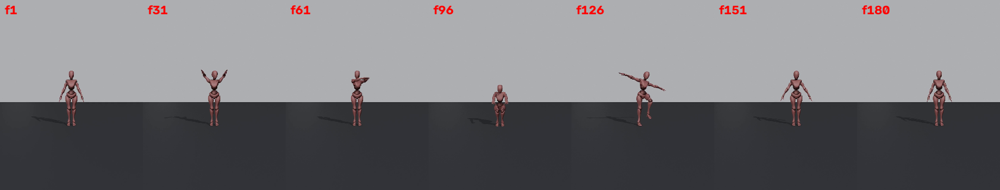
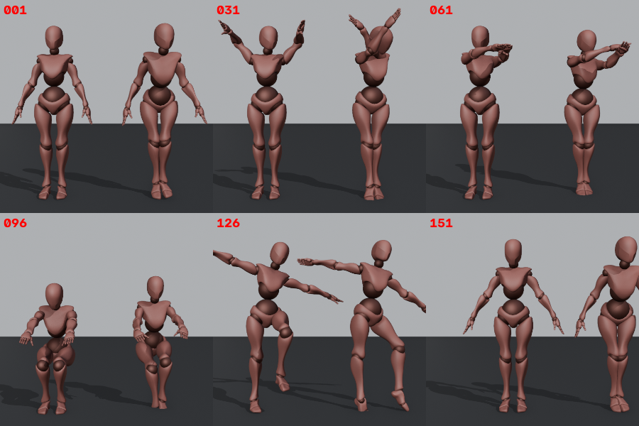

# Fase 2 — Prueba de viabilidad: informe

Fecha: 2026-10-26 · Blender 5.1.2 · MediaPipe 1.1.1 · Windows 10, CPU Ryzen 7 5800H (sin GPU NVIDIA)

## 1. Resultado

El flujo completo funciona de principio a fin, sin tocar keyframes a mano:

**vídeo → motor (MediaPipe, proceso aislado) → contrato v1 (`result.json` + `motion.npz`) → retargeting → Action nativa de Blender**

Comprobado con pruebas automáticas:

- Se crea una Action nueva con **75 F-Curves** (cuaterniones de 18 huesos más la posición de la raíz) y un keyframe por fotograma.
- La Action se puede **reproducir y editar**, y **se conserva al guardar y volver a abrir** el `.blend`.
- Las Actions que ya existían quedan intactas.
- Una **segunda generación crea una Action nueva** (`.001`) sin destruir la primera.
- Los vídeos inválidos o inexistentes producen errores con código propio: `VIDEO_UNREADABLE` y `VIDEO_NOT_FOUND`.

## 2. Cómo se ha medido: prueba de bucle cerrado

No había vídeos de prueba con licencia clara, así que se creó una referencia exacta:

1. El X Bot se anima con un movimiento **conocido**: brazos abajo, arriba y al frente con codos flexionados, giro e inclinación del torso, cabeza, sentadilla, pierna levantada con giro de pelvis y paso lateral.
2. Se renderiza un vídeo de 6 s a 30 fps desde una cámara frontal (`tests/e2e/make_ground_truth.py`).



3. El vídeo pasa por el motor y por el retargeting, aplicado a una copia del personaje.
4. Blender evalúa las dos armaduras fotograma a fotograma y compara (`tests/e2e/evaluate.py`):
   - **error de dirección:** el ángulo entre los ejes de cada hueso;
   - **error de rotación:** el ángulo total, incluido el giro del hueso sobre sí mismo;
   - **error de raíz:** la distancia entre las caderas, en metros.

Todo el ciclo se repite con un solo comando: `tests/e2e/run_closed_loop.py`.



## 3. Métricas (modelo `full`, ajustes por defecto)

| Métrica | Valor |
|---|---|
| Fotogramas con persona detectada | 100 % |
| Error de dirección, todos los huesos: mediana / media / p95 | **12,8° / 17,3° / 47°** |
| Error de raíz: mediana / p95 | **7 cm / 27 cm** |
| Tiempo de IA (180 fotogramas, CPU) | 4,7 s (~38 fps) |
| Tiempo de retargeting y escritura de keyframes | 0,11 s |

Error mediano por hueso, en grados. La columna «reposo» indica el error que habría si el personaje no se moviera, como referencia.

| Hueso | Dirección | Rotación completa | Reposo |
|---|---|---|---|
| Cadera | 13,2 | 15,7 | 0 |
| Pecho (Spine2) | 12,2 | 13,7 | 0,6 |
| Cabeza | 11,5 | 18,3 | 10,6 |
| Brazo izq. / der. | 15,3 / 22,1 | 27,3 / 27,6 | 56,5 / 61,7 |
| Antebrazo izq. / der. | 14,5 / 10,3 | 29,6 / 24,1 | 69,7 / 70,3 |
| Mano izq. / der. | 12,7 / 15,9 | 37,0 / 31,3 | 69,7 / 70,3 |
| Muslo izq. / der. | 11,4 / 10,8 | 13,0 / 13,0 | 0 |
| Espinilla izq. / der. | 7,2 / 7,9 | 8,3 / 10,3 | 0 |
| Pie izq. / der. | 16,5 / 15,9 | 17,0 / 16,0 | 0 |

**Cómo leer la tabla:**

- **Brazos:** la captura reduce el error de ~65° (sin captura) a ~15°.
- **Piernas y cadera:** en la referencia pasan casi todo el tiempo quietas, así que su mediana sin captura es 0°. La captura añade un sesgo de ~10° (rodillas ligeramente hacia dentro y algo flexionadas), que viene de MediaPipe y no del retargeting (ver §5).
- **Giro de brazos y manos:** el error de rotación completa (~25–37°) es mayor que el de dirección porque el giro de un hueso sobre su eje es lo más difícil de observar con una sola cámara.

**Modelo `heavy`:** con este maniquí da peor resultado (media de 25°) y es 2,4 veces más lento (11,2 s). Se mantiene `full` por defecto. Esta conclusión sale de un robot sin rostro y debe confirmarse con vídeo de personas reales.

## 4. Problemas encontrados y corregidos durante la fase

| Problema detectado por la prueba | Corrección | Efecto medido |
|---|---|---|
| Con la figura pequeña en el encuadre, MediaPipe se «enganchaba» a una pose **invertida** (brazos levantados tomados por piernas) | Protección `assume_upright`: si el torso sale invertido, se vuelve a detectar el fotograma sin seguimiento y se reinicia el tracker | Evita poses del revés en vídeos reales |
| **Confusión delante/detrás** (la cadera girada 180°) | Algoritmo de Viterbi sobre dos interpretaciones por fotograma, la detectada y la girada (lados intercambiados y profundidad invertida), eligiendo la temporalmente continua. Supuesto por defecto: la persona empieza mirando a la cámara | Rotación de cadera con `heavy`: 128° → 20°. Error máximo con `full`: 179° → 107° |
| El personaje **flotaba** unos 12 cm: MediaPipe infravalora la longitud de las piernas | La escala usa la relación de alturas de cadera (coherente con la estimación de la raíz) | Error de raíz: 15 cm → 7 cm |
| Codo o rodilla doblados hacia el lado imposible (**ambigüedad de profundidad**) | Restricción anatómica: si la torsión resultante es implausible, se usa el segmento reflejado en profundidad | Mejora en piernas con `heavy` (muslo 48° → 35°); efecto pequeño en brazos (umbral 140°) |
| Los mensajes de error con tildes rompían la comunicación en Windows (cp1252) | La salida del motor se fuerza a UTF-8 | Corregido |

## 5. Limitaciones que siguen abiertas

1. **Giro del húmero con los brazos por encima de la cabeza:** sigue habiendo fotogramas con mucho error de giro (p95 de rotación de ~150° en los brazos). Hace falta mejor información del giro del brazo, por ejemplo la orientación de la mano o un modelo 3D con manos (RTMW3D). Queda para la Fase 4.
2. **Sesgo en las piernas:** MediaPipe sitúa los tobillos de este maniquí casi juntos y las rodillas algo flexionadas, lo que da rodillas hacia dentro. Hay que comprobarlo con personas reales antes de corregirlo; una opción es calibrar con los primeros fotogramas en pose neutra.
3. **Profundidad de la sentadilla infravalorada:** los muslos apuntan hacia la cámara y la profundidad es ambigua. Es una limitación de usar una sola cámara.
4. **Dedos:** no se capturan. La mano se orienta de forma aproximada con 3 puntos y un peso de 0,7.
5. **Pies:** no hay bloqueo de contacto con el suelo, así que puede haber deslizamiento. Queda para la Fase 4.
6. **Validación con humanos reales: pendiente.** Todas las cifras proceden de un maniquí renderizado. Los vídeos de personas reales suelen detectarse mejor (hay rostro y textura), pero no hay que darlo por hecho.
7. La trayectoria raíz supone una **cámara fija y nivelada**. Si la cámara se mueve, esa trayectoria no es válida.

## 6. Pruebas automatizadas

| Conjunto | Cómo se ejecuta | Resultado |
|---|---|---|
| Unitarias: rotaciones, mapeo (Mixamo, Rigify, Unreal, rig no reconocido), solver con ida y vuelta exacta sobre el X Bot, filtros temporales, resolución delante/detrás | `pytest tests/unit` (Python del motor) | **22/22 OK** |
| Integración en Blender: Action, F-Curves, edición, segunda generación, guardar y reabrir dos veces | `blender -b --python tests/blender/test_persistence.py -- …` | **13/13 OK** |
| End-to-end de bucle cerrado con métricas | `tests/e2e/run_closed_loop.py` | Métricas del §3 |
| Vídeo corrupto o inexistente | `tools/run_on_video.py` | Error con código propio (OK) |

## 7. Archivos de la fase

```
engine/ai_mocap_engine/   cli.py, pipeline.py, video_io.py, temporal.py, root.py, skeleton.py,
                          backends/{base, mediapipe_backend}.py
addon/ai_mocap/           rig/{mapping, detect}.py, retarget/{rotations, solver}.py,
                          anim/writer.py, core/{contract, apply}.py
tests/unit/               22 pruebas  ·  tests/blender/test_persistence.py  ·  tests/e2e/*
tests/fixtures/           xbot_rest.npz (pose de reposo exportada desde Blender)
tools/run_on_video.py     prototipo: vídeo + FBX → .blend con la Action
```

## 8. Siguiente fase (Fase 3)

Addon instalable con interfaz completa: paneles A–F, operador modal no bloqueante con progreso y cancelación, instalador del motor desde las preferencias (venv, dependencias y modelo con verificación), caché de resultados, panel de mapeo manual con presets guardados y opciones de salida.
